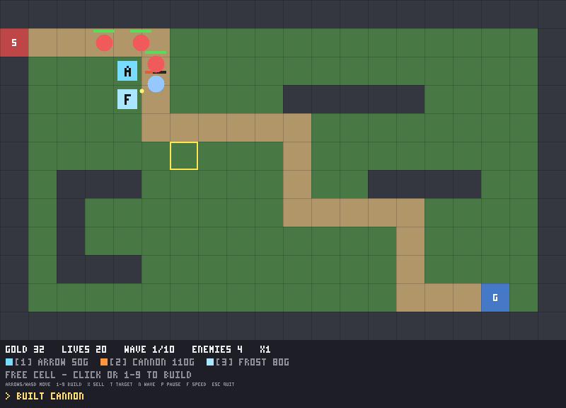

# LearnToDraw — petit moteur de tower defense en C++

Un moteur de jeu compact (C++17, sans dépendance obligatoire) pour fabriquer des
tower defense sur grille. Le moteur simule tout : carte, chemin des ennemis,
vagues, tours, projectiles, économie. Il ne sait rien de l'affichage : on lui
branche un *frontend*. Deux sont fournis :

- **Terminal** (ANSI, inclus dans le moteur) : fonctionne partout, sans rien installer.
- **SDL2** (optionnel) : fenêtre graphique, souris, barres de vie.



## Compiler et lancer

```sh
cmake -S . -B build -DCMAKE_BUILD_TYPE=Release
cmake --build build -j
./build/td_tests          # tests unitaires
./build/td_demo           # démo dans le terminal
./build/td_demo --sdl     # démo dans une fenêtre SDL2 (si SDL2 était présent au cmake)
```

SDL2 est détecté automatiquement (`libsdl2-dev` sous Debian/Ubuntu, `sdl2` sous
Homebrew). Sans lui, seul le frontend terminal est compilé.

Touches : flèches ou WASD/ZQSD pour le curseur, `1`-`9` construire, `x` vendre,
`t` changer le ciblage, `n` vague suivante, `p` pause, `f` vitesse (x1, x2, x4),
`Échap` quitter. En SDL2 la souris déplace le curseur, clic gauche construit la
dernière tour choisie, clic droit vend.

## Organisation

```
engine/include/td/   API publique du moteur (namespace td)
  Math.hpp           Vec2, GridPos, Color
  Grid.hpp           Carte en tuiles, chargée depuis de l'ASCII
  Pathfinding.hpp    Plus court chemin (BFS) et points de passage
  Definitions.hpp    EnemyType, TowerType, WaveDef, Targeting (données de conception)
  Entities.hpp       Enemy, Tower, Projectile (instances en jeu)
  World.hpp          État et simulation d'une partie
  Frontend.hpp       Interfaces IRenderer / IInput et commandes du joueur
  Game.hpp           Boucle à pas fixe reliant World, rendu et entrées
  Terminal.hpp       Frontend texte
engine/src/          Implémentation
backends/sdl2/       Frontend SDL2 (SdlFrontend, SdlInput)
examples/demo/       Jeu d'exemple complet (carte, 3 ennemis, 3 tours, 10 vagues)
tests/               Tests unitaires (aucun framework requis)
```

## Écrire son propre jeu

Tout passe par `td::World`. On lui donne une carte, des types d'ennemis et de
tours, des vagues, puis on le fait avancer avec `update(dt)`.

```cpp
#include "td/Game.hpp"
#include "td/Terminal.hpp"

int main() {
    // # décor  . constructible  = chemin  S spawn  G base
    td::Grid grid = td::Grid::fromAscii({
        "#########",
        "S====...#",
        "#...=...#",
        "#...===G#",
        "#########",
    });
    td::World world(grid);               // lève une exception si S n'est pas relié à G

    td::EnemyType grunt;
    grunt.name = "Grunt"; grunt.maxHp = 30; grunt.speed = 1.5f; grunt.reward = 5;
    const int kGrunt = world.addEnemyType(grunt);

    td::TowerType arrow;
    arrow.name = "Arrow"; arrow.cost = 50; arrow.range = 2.5f; arrow.damage = 8; arrow.fireRate = 2;
    world.addTowerType(arrow);

    td::WaveDef wave;
    wave.groups.push_back({kGrunt, /*count*/ 8, /*interval*/ 0.8f, /*delay*/ 0.f});
    world.addWave(wave);

    world.events.onEnemyKilled = [](const td::Enemy&) { /* son, particules... */ };

    td::TerminalRenderer renderer("Mon TD");
    td::TerminalInput input;
    td::Game game(world, renderer, input);
    game.run();
}
```

### Ce que gère le moteur

- **Carte** : grille rectangulaire ASCII, plusieurs spawns possibles (les ennemis
  alternent entre eux), une base. Chemin calculé une fois par spawn.
- **Ennemis** : points de vie, vitesse, récompense, dégâts à la base. Suivent les
  points de passage, peuvent être ralentis.
- **Tours** : coût, portée, dégâts, cadence, vitesse de projectile, dégâts de zone
  (`splashRadius`), ralentissement (`slowFactor` + `slowDuration`). Cinq stratégies
  de ciblage : premier, dernier, plus proche, plus fort, plus faible.
- **Projectiles** : guidés, touchent toujours ; s'ils arrivent après la mort de la
  cible, une tour à zone explose quand même à la dernière position connue.
- **Vagues** : groupes `{type, nombre, intervalle, délai}`. Départ automatique
  avec compte à rebours (`WorldConfig::waveCountdown`) ou manuel (`startNextWave`).
- **Économie** : or de départ, vies, revente avec remboursement partiel.
- **Fin de partie** : défaite à zéro vie, victoire quand la dernière vague est nettoyée.
- **Événements** : `WorldEvents` expose des callbacks (apparition, mort, tir,
  début/fin de vague, fin de partie) pour brancher sons, effets ou statistiques.

### Brancher un autre affichage

Implémentez `td::IRenderer::render(const World&, const ViewState&)` pour dessiner
et `td::IInput::poll()` pour produire des `td::Command` (déplacer le curseur,
construire, vendre, etc.). `td::Game` s'occupe du reste : pas de simulation fixe
(1/60 s par défaut), pause, accélération, messages. `backends/sdl2/SdlFrontend.cpp`
est un exemple complet d'une centaine de lignes de dessin.

Si vous préférez votre propre boucle, appelez `game.step(dt)` à chaque image, ou
ignorez `Game` et pilotez `World::update` directement.

## Licence

MIT, voir `LICENSE`.
